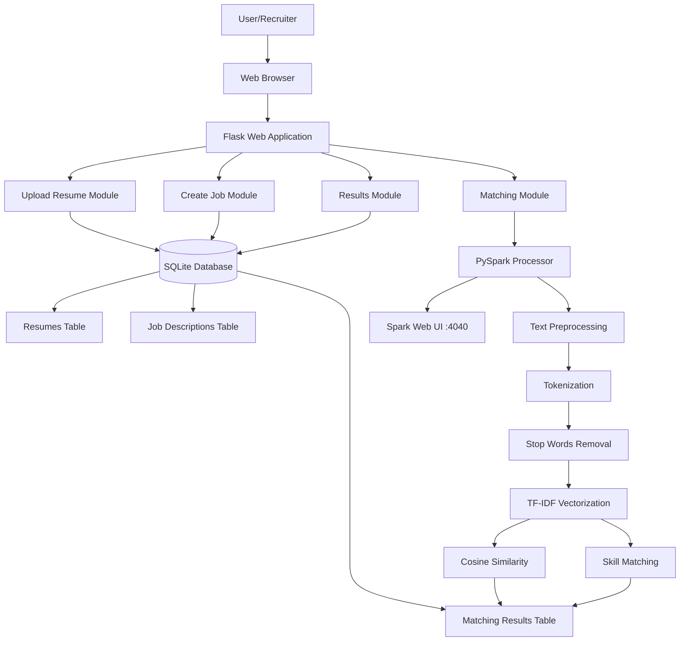
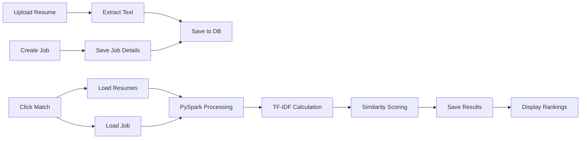
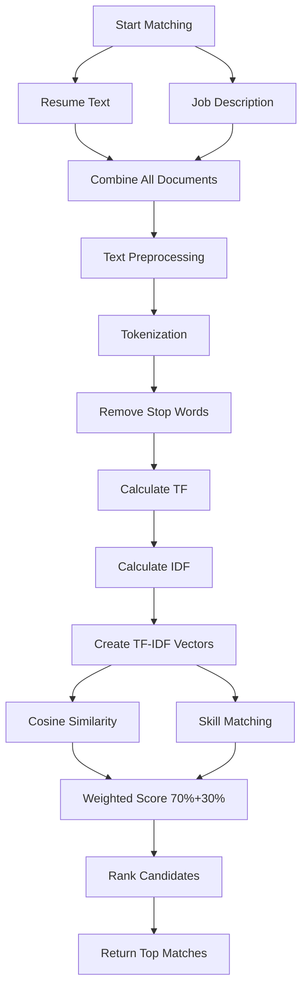

# Resume Matching System - Architecture Documentation

## System Architecture Diagram



## Data Flow Diagram



## Matching Algorithm Flow



## Component Interactions

### 1. Resume Upload Flow
```
User selects file
    ↓
Flask receives POST request
    ↓
Validate file type (PDF/DOCX/TXT)
    ↓
Extract text content
    ↓
Database.add_resume(name, filename, content)
    ↓
Store in resumes table
    ↓
Display success message
```

### 2. Job Creation Flow
```
User fills form
    ↓
Flask receives POST request
    ↓
Validate required fields
    ↓
Database.add_job_description(title, desc, skills)
    ↓
Store in job_descriptions table
    ↓
Display success message
```

### 3. Matching Process Flow
```
User clicks "Match Resumes"
    ↓
Flask triggers matching route
    ↓
Load all resumes from database
    ↓
Load target job description
    ↓
Get PySpark processor instance
    ↓
Create Spark DataFrame with all documents
    ↓
Apply transformations:
    1. Tokenizer
    2. StopWordsRemover
    3. HashingTF
    4. IDF
    ↓
Extract TF-IDF vectors
    ↓
Calculate cosine similarity with job vector
    ↓
Extract matched skills from resume
    ↓
Calculate final weighted score
    ↓
Sort by score (descending)
    ↓
Save to matching_results table
    ↓
Redirect to results page
```

## Database Schema

```
┌─────────────────────────┐
│      resumes            │
├─────────────────────────┤
│ id (PK)                 │
│ candidate_name          │
│ file_name               │
│ file_content (TEXT)     │
│ upload_date             │
│ created_at              │
└─────────────────────────┘
            ↑
            │
            │ (FK resume_id)
            │
┌─────────────────────────┐
│  matching_results       │
├─────────────────────────┤
│ id (PK)                 │
│ resume_id (FK)          │
│ job_id (FK)             │
│ matching_score          │
│ matched_skills          │
│ created_at              │
└─────────────────────────┘
            ↓
            │ (FK job_id)
            │
            ↓
┌─────────────────────────┐
│  job_descriptions       │
├─────────────────────────┤
│ id (PK)                 │
│ job_title               │
│ description (TEXT)      │
│ required_skills         │
│ created_at              │
└─────────────────────────┘
```

## Technology Stack Layers

```
┌─────────────────────────────────────────┐
│         Presentation Layer              │
│  HTML5 + CSS3 + Jinja2 Templates       │
└─────────────────────────────────────────┘
                  ↓
┌─────────────────────────────────────────┐
│        Application Layer                │
│     Flask 3.0 Web Framework             │
│  - Routing                              │
│  - Request Handling                     │
│  - File Processing                      │
└─────────────────────────────────────────┘
                  ↓
┌─────────────────────────────────────────┐
│         Business Logic Layer            │
│  - Resume Management                    │
│  - Job Management                       │
│  - Matching Algorithm                   │
└─────────────────────────────────────────┘
                  ↓
┌─────────────────────────────────────────┐
│       Processing Layer                  │
│    Apache Spark 3.5 (PySpark)           │
│  - TF-IDF Vectorization                 │
│  - ML Pipeline                          │
│  - Distributed Computing                │
└─────────────────────────────────────────┘
                  ↓
┌─────────────────────────────────────────┐
│         Data Layer                      │
│         SQLite Database                 │
│  - Data Persistence                     │
│  - CRUD Operations                      │
└─────────────────────────────────────────┘
```

## PySpark ML Pipeline

```
Input Text
    ↓
┌─────────────────────┐
│    Tokenizer        │
│  Split into words   │
└─────────────────────┘
    ↓
┌─────────────────────┐
│ StopWordsRemover    │
│ Filter common words │
└─────────────────────┘
    ↓
┌─────────────────────┐
│    HashingTF        │
│ Term Frequency      │
│ (1000 features)     │
└─────────────────────┘
    ↓
┌─────────────────────┐
│       IDF           │
│ Inverse Doc Freq    │
└─────────────────────┘
    ↓
TF-IDF Vector Output
```

## Scoring Algorithm

```python
# Step 1: TF-IDF Similarity
tfidf_similarity = cosine_similarity(resume_vector, job_vector)

# Step 2: Skill Matching
matched_skills = [skill for skill in required_skills 
                  if skill.lower() in resume_text.lower()]
skill_match_percentage = len(matched_skills) / len(required_skills)

# Step 3: Weighted Final Score
final_score = (tfidf_similarity * 0.7) + (skill_match_percentage * 0.3)
final_percentage = final_score * 100
```

## File Processing Pipeline

```
Upload File (PDF/DOCX/TXT)
    ↓
Secure Filename Generation
    ↓
Save to uploads/ directory
    ↓
┌─────────────────────────────────┐
│  File Type Detection            │
├─────────────────────────────────┤
│  .txt  → Read as plain text     │
│  .pdf  → PyPDF2.PdfReader       │
│  .docx → python-docx.Document   │
└─────────────────────────────────┘
    ↓
Extract Text Content
    ↓
Store in Database (file_content column)
```

## API Endpoints Structure

```
GET  /                       → Home Page
GET  /upload_resume          → Upload Form
POST /upload_resume          → Process Upload
GET  /create_job             → Job Form
POST /create_job             → Process Job
GET  /match_resumes/<id>     → Run Matching
GET  /results/<id>           → Display Results
GET  /spark_ui               → Redirect to Spark UI
GET  /api/resumes            → JSON: All Resumes
GET  /api/jobs               → JSON: All Jobs
GET  /api/results/<id>       → JSON: Match Results
```

## Security Measures

```
File Upload Security:
    ↓
┌─────────────────────────────┐
│  1. Extension Validation    │
│     (txt, pdf, docx only)   │
└─────────────────────────────┘
    ↓
┌─────────────────────────────┐
│  2. Size Limitation         │
│     (Max 16MB)              │
└─────────────────────────────┘
    ↓
┌─────────────────────────────┐
│  3. Secure Filename         │
│     (Sanitized paths)       │
└─────────────────────────────┘
    ↓
┌─────────────────────────────┐
│  4. SQL Injection           │
│     Prevention              │
│     (Parameterized queries) │
└─────────────────────────────┘
```

## Performance Optimization

### Spark Configuration
- **Driver Memory**: 2GB (configurable)
- **Shuffle Partitions**: 4 (adjustable for parallelism)
- **Master**: local[*] (uses all available cores)

### Database Optimization
- **Indexes**: Primary keys on all tables
- **Foreign Keys**: Maintain referential integrity
- **Connection Pooling**: Single connection per request

### Caching Strategy
- **Spark**: Caches TF-IDF model for reuse
- **Database**: No caching (direct queries)
- **Static Files**: Served directly by Flask

## Deployment Architecture

```
┌─────────────────────────────────────┐
│   Local Development Environment     │
├─────────────────────────────────────┤
│  Flask Server: localhost:5000       │
│  Spark UI: localhost:4040            │
│  Database: data/resume_matching.db  │
│  Uploads: uploads/                  │
└─────────────────────────────────────┘

Production Deployment Options:
    ↓
┌─────────────────────────────────────┐
│  Option 1: Cloud Deployment         │
│  - AWS EC2 + RDS                    │
│  - Azure VM + SQL Database          │
│  - Google Compute Engine            │
└─────────────────────────────────────┘
    ↓
┌─────────────────────────────────────┐
│  Option 2: Container Deployment     │
│  - Docker containerization          │
│  - Kubernetes orchestration         │
│  - Docker Compose for services      │
└─────────────────────────────────────┘
```

## Monitoring & Logging

```
Application Logs
    ↓
Console Output (print statements)

Spark Monitoring
    ↓
Spark Web UI (http://localhost:4040)
    ↓
┌─────────────────────────┐
│  Jobs Tab               │
│  - Job execution status │
│  - Duration             │
│  - Stages breakdown     │
└─────────────────────────┘
    ↓
┌─────────────────────────┐
│  Stages Tab             │
│  - Task count           │
│  - Data size            │
│  - Shuffle metrics      │
└─────────────────────────┘
    ↓
┌─────────────────────────┐
│  Executors Tab          │
│  - Memory usage         │
│  - Task execution       │
│  - Failed tasks         │
└─────────────────────────┘
```

## Error Handling Flow

```
User Action
    ↓
Try-Except Block
    ↓
┌─────────────────────────┐
│  Error Detected?        │
└─────────────────────────┘
    ↓              ↓
   Yes            No
    ↓              ↓
Log Error    Continue Processing
    ↓              ↓
Flash Message  Success Message
    ↓              ↓
Redirect      Display Results
```

## Scalability Considerations

### Current Capacity
- Resumes: 1000+ simultaneously
- Processing Time: ~5-10 seconds for 100 resumes
- Concurrent Users: Single-threaded (development)

### Scaling Options
1. **Horizontal Scaling**: Deploy multiple Flask instances
2. **Vertical Scaling**: Increase Spark driver memory
3. **Distributed Spark**: Use Spark cluster instead of local mode
4. **Database Scaling**: Migrate to PostgreSQL/MySQL
5. **Caching Layer**: Add Redis for session management

---

**Architecture Version**: 1.0  
**Last Updated**: November 2024  
**Technology Stack**: Flask + PySpark + SQLite
